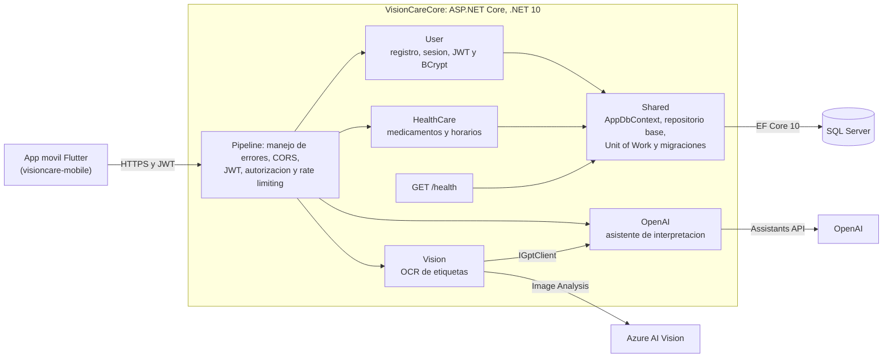
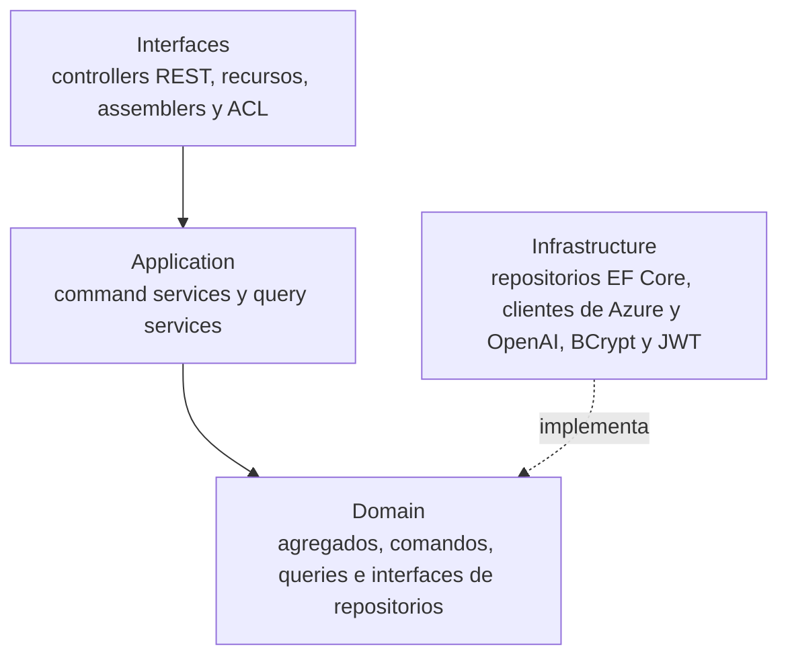

# VisionCare Backend

[](https://github.com/BrunoPa23/visioncare-backend/actions/workflows/ci.yml)

> **Muestra publica de portafolio.** Version publica y saneada del backend de VisionCare, proyecto final del curso Seminario de Investigacion Academica (Ingenieria de Software, UPC, 2025), desarrollado en equipo por Bruno Palomino y William Riega. No incluye configuracion sensible, artefactos de compilacion ni el pipeline de despliegue original. La app movil esta en [visioncare-mobile](https://github.com/BrunoPa23/visioncare-mobile).

VisionCare ayuda a las personas a gestionar sus medicamentos: reconoce el texto de la etiqueta de un medicamento a partir de una foto, lo interpreta con un asistente de OpenAI y permite programar recordatorios de toma desde la app movil.

## Funcionalidades

- Registro, inicio de sesion, refresh token y cierre de sesion con JWT (token por header o cookie)
- Contrasenas con hash BCrypt
- Reconocimiento de texto en fotos de medicamentos con Azure AI Vision (OCR)
- Interpretacion del texto reconocido con un asistente de OpenAI
- Gestion de medicamentos por usuario y de sus horarios de toma
- Rate limiting en escaneo, asistente e inicio de sesion (429 con ProblemDetails)
- Health check en `/health` con verificacion de la base de datos
- Esquema versionado con migraciones de EF Core
- Arranque completo (API y SQL Server) con docker-compose

## Arquitectura

Monolito modular organizado por bounded contexts siguiendo Domain Driven Design:

```
VisionCareCore/
├── User/         Autenticacion, usuarios, JWT y BCrypt
├── HealthCare/   Medicamentos y horarios de toma
├── Vision/       Reconocimiento de imagenes con Azure AI Vision
├── OpenAI/       Integracion con el asistente de OpenAI
└── Shared/       AppDbContext, repositorio base con Guid, Unit of Work, migraciones,
                  manejo de errores, health checks y rate limiting
```

Cada contexto separa sus capas en carpetas `Domain`, `Application`, `Infrastructure` e `Interfaces`.

| Capa | Responsabilidad |
|---|---|
| Domain | Entidades, agregados e interfaces de repositorios y servicios |
| Application | Command services y query services (lecturas y escrituras separadas) |
| Infrastructure | EF Core sobre SQL Server, clientes de APIs externas, hashing y tokens |
| Interfaces | Controllers REST, recursos y assemblers; ACL entre contextos |

### Diagrama de arquitectura

Bounded contexts, servicios externos y base de datos. Cada peticion pasa por el pipeline de middleware antes de llegar al controller de su contexto:



Capas dentro de cada contexto (las dependencias apuntan hacia el dominio):



## Endpoints

| Metodo | Ruta | Descripcion |
|---|---|---|
| POST | /vc/v1/authentication/sign-up | Registro de usuario |
| POST | /vc/v1/authentication/sign-in | Inicio de sesion, devuelve JWT |
| POST | /vc/v1/authentication/refresh-token | Renueva el token |
| POST | /vc/v1/authentication/sign-out | Cierra la sesion |
| GET | /vc/v1/auth-user/me | Usuario autenticado |
| GET | /vc/v1/auth-user/{authUserId} | Datos del propio usuario por id |
| POST | /vc/v1/vision/recognize-image | OCR de la foto de un medicamento |
| POST | /vc/v1/vision/scan | Escaneo de medicamento (OCR e interpretacion) |
| POST | /vc/v1/gpt/test | Procesa texto con el asistente de OpenAI |
| GET | /vc/v1/gpt/test-connection | Verifica la conexion con OpenAI |
| POST | /api/medicine | Registra un medicamento |
| GET | /api/medicine/user/{userId} | Medicamentos de un usuario |
| DELETE | /api/medicine/{id} | Elimina un medicamento |
| POST | /api/medicine-time | Programa un horario de toma |
| POST | /api/medicine-time/update-all | Actualiza varios horarios |
| GET | /api/medicine-time/by-medicine/{medicineId} | Horarios de un medicamento |
| GET | /api/medicine-time/{id} | Horario por id |
| DELETE | /api/medicine-time/{id} | Elimina un horario |
| GET | /health | Estado de la API y de la base de datos |

Todos los endpoints requieren un JWT valido, enviado en el header `Authorization: Bearer <token>` o en la cookie `AuthToken`, excepto `sign-up`, `sign-in`, `refresh-token` y `/health`. Sin token la API responde 401.

Los errores no controlados responden 500 con un cuerpo ProblemDetails (`application/problem+json`) que solo incluye un titulo generico y el `traceId`; el detalle de la excepcion queda en el log del servidor. Al superar un limite de peticiones la respuesta es 429, tambien con ProblemDetails (ver [Rate limiting](#rate-limiting)).

La documentacion interactiva esta disponible en Swagger al ejecutar la API.

## Stack

- .NET 10, ASP.NET Core Web API
- Entity Framework Core 10 con SQL Server
- JWT Bearer y BCrypt.Net
- Azure AI Vision (Image Analysis) y OpenAI
- Swagger (Swashbuckle 10)
- Rate limiting nativo de ASP.NET Core y health checks con EF Core
- Docker (imagen multi-stage) y docker-compose con SQL Server 2022
- xUnit, NSubstitute y WebApplicationFactory con SQLite en memoria
- GitHub Actions: build, tests y prueba de la imagen con docker-compose

## Como ejecutarlo

Requisitos: .NET 10 SDK y una instancia de SQL Server.

1. Configura la base de datos y el secreto JWT con user-secrets:

```bash
cd VisionCareCore
dotnet user-secrets init
dotnet user-secrets set "ConnectionStrings:DefaultConnection" "<cadena de conexion a SQL Server>"
dotnet user-secrets set "TokenSettings:Secret" "<clave de al menos 32 caracteres>"
```

2. Configura las claves de los servicios externos con user-secrets o variables de entorno (en variables de entorno, `:` se escribe `__`):

| Clave de configuracion | Variable de entorno | Uso |
|---|---|---|
| AzureVision:Endpoint | AzureVision__Endpoint | Endpoint de Azure AI Vision |
| AzureVision:Key | AzureVision__Key | Clave de Azure AI Vision |
| OpenAI:ApiKey | OpenAI__ApiKey | Clave de la API de OpenAI |
| OpenAI:AssistantId | OpenAI__AssistantId | Id del asistente de OpenAI |

La API valida estas claves al arrancar: si falta alguna o el endpoint no es una URL valida, no inicia y muestra que valor falta.

3. Ajusta los origenes permitidos de CORS en `appsettings.json` (seccion `Cors:OrigenesPermitidos`). En el mismo archivo, `TokenSettings:Issuer` y `TokenSettings:Audience` definen el emisor y la audiencia que la API firma y exige en cada JWT.

4. Ejecuta la API y abre Swagger en la URL que muestra la consola. En `Development` la API aplica las migraciones pendientes al arrancar (ver [Migraciones](#migraciones-de-base-de-datos)):

```bash
dotnet run --project VisionCareCore
```

## Arranque con docker-compose

Requisito: Docker con Compose v2. Levanta la API y SQL Server 2022 con un solo comando:

```bash
docker compose up -d --build
```

- La API queda en `http://localhost:5080` (Swagger en `/swagger`, salud en `/health`) y SQL Server en `localhost:1433`.
- La API espera a que SQL Server pase su healthcheck (`sqlcmd SELECT 1`) y aplica las migraciones al arrancar (`Database__AplicarMigraciones=true`).
- Los datos de SQL Server viven en el volumen `sqlserver-data`; `docker compose down -v` lo borra.
- La imagen de la API es multi-stage: compila con el SDK de .NET 10 y corre sobre `aspnet:10.0` con un usuario sin privilegios.

Todas las variables tienen valores falsos por defecto, suficientes para desarrollo. Para cambiarlas, copia `.env.example` a `.env` (ignorado por git):

| Variable de `.env` | Se pasa a la API como | Uso |
|---|---|---|
| MSSQL_SA_PASSWORD | parte de `ConnectionStrings__DefaultConnection` | Contrasena de `sa` en SQL Server |
| TOKEN_SECRET | `TokenSettings__Secret` | Clave de firma JWT (32 caracteres o mas) |
| AZURE_VISION_ENDPOINT, AZURE_VISION_KEY | `AzureVision__Endpoint`, `AzureVision__Key` | Azure AI Vision |
| OPENAI_API_KEY, OPENAI_ASSISTANT_ID | `OpenAI__ApiKey`, `OpenAI__AssistantId` | Asistente de OpenAI |
| API_PORT, SQLSERVER_PORT | puertos publicados | 5080 y 1433 por defecto |

Con las claves falsas la API arranca y funcionan la autenticacion, los medicamentos y los horarios; el escaneo y el asistente necesitan claves reales (con las falsas responden error).

La imagen `mcr.microsoft.com/mssql/server` solo existe para x64: en equipos ARM64 necesita emulacion (Docker Desktop con Rosetta o QEMU). El workflow de CI construye la imagen, levanta el compose y verifica `/health` en cada PR.

## Health checks

`GET /health` es publico y responde JSON con el estado general y el de cada verificacion (hoy, la conexion a la base de datos con EF Core). Devuelve 200 si todo esta sano y 503 si la base no responde; nunca incluye mensajes de error ni datos de conexion.

```json
{ "status": "Healthy", "duracionMs": 12.3, "checks": [ { "nombre": "base-de-datos", "status": "Healthy", "duracionMs": 11.8 } ] }
```

## Rate limiting

La API usa el middleware nativo de ASP.NET Core con ventana fija y sin cola:

| Politica | Endpoints | Particion | Limite por defecto |
|---|---|---|---|
| vision | `vision/scan`, `vision/recognize-image` | usuario autenticado | 10 por minuto |
| gpt | `gpt/test`, `gpt/test-connection` | usuario autenticado | 20 por minuto |
| sign-in | `authentication/sign-in` | IP | 5 por minuto |

Al superar el limite la API responde 429 con ProblemDetails y la cabecera `Retry-After`. Los limites se cambian en la seccion `RateLimiting` de `appsettings.json` o con variables como `RateLimiting__SignIn__PermitLimit` y `RateLimiting__SignIn__WindowSeconds`; si un valor es 0 o negativo la API no arranca. Detras de un proxy hay que configurar `ForwardedHeaders` para que la IP sea la del cliente.

## Migraciones de base de datos

El esquema se versiona con migraciones de EF Core (carpeta `Migrations` dentro de `Shared`). La herramienta `dotnet-ef` esta declarada como herramienta local en `.config/dotnet-tools.json`:

```bash
dotnet tool restore
dotnet ef migrations add <Nombre> --project VisionCareCore
dotnet ef database update --project VisionCareCore
```

- En `Development` la API aplica las migraciones pendientes al arrancar.
- En otros entornos solo lo hace si `Database:AplicarMigraciones` es `true` (variable `Database__AplicarMigraciones`); si no, se aplican aparte con `dotnet ef database update` o con un script generado por `dotnet ef migrations script --idempotent`.
- Una base creada antes con `EnsureCreated` no tiene la tabla `__EFMigrationsHistory`: hay que recrearla o registrar a mano la migracion `Inicial` en esa tabla.
- Los tests de integracion usan SQLite en memoria y crean el esquema desde el modelo, sin migraciones.

## Tests

```bash
dotnet test VisionCareCore.sln
```

- Unitarios de los servicios de medicamentos y horarios con NSubstitute.
- Integracion con `WebApplicationFactory`: la API completa sobre SQLite en memoria (esquema creado desde el modelo) y claves falsas. Cubren autenticacion, propiedad de recursos, validacion de configuracion al arrancar, `/health`, las respuestas 429 y el repositorio base.
- Ningun test llama a Azure ni a OpenAI.

El workflow de CI (`.github/workflows/ci.yml`) compila y corre los tests con .NET 10 y, en un segundo job, construye la imagen, levanta el docker-compose y verifica `/health`.

## Equipo

- Bruno Palomino ([@BrunoPa23](https://github.com/BrunoPa23))
- William Riega
